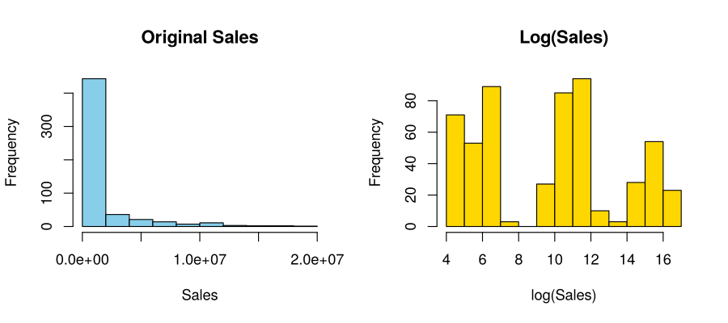
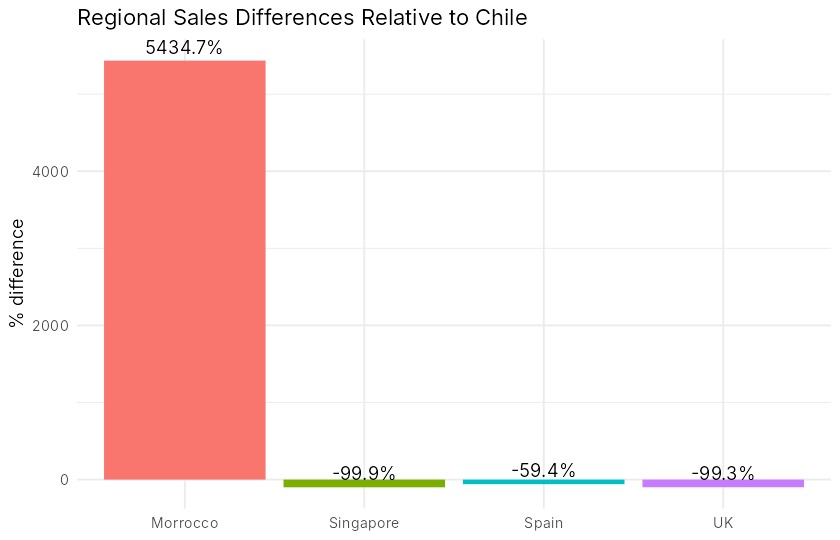
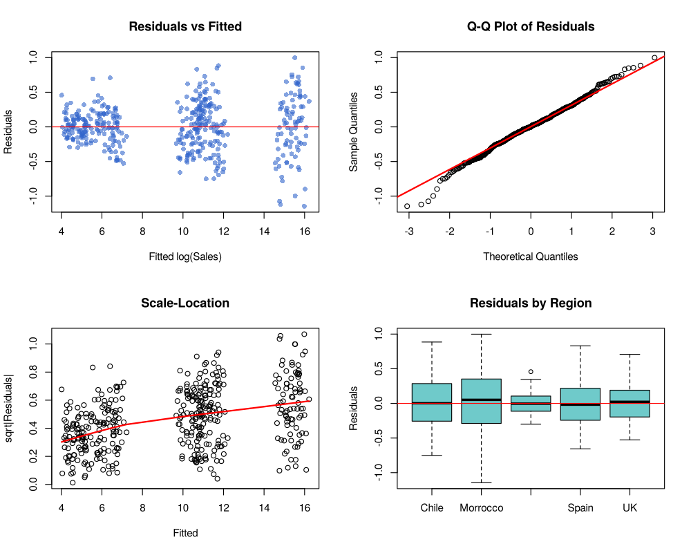

# Marketing Mix Modelling: Lollipops Across Five Markets

**How much do TV ads, online banners and in-store promotions drive sales, and which channel gives the best return?**

MSc Business Analytics group project, University of Manchester

`R` · `lm` · `MASS::stepAIC` · `car` · `lmtest` · `ggplot2`

---

## 📌 Business question
A confectionery brand sells lollipops in Chile, Morocco, Singapore, Spain and the UK. Management wants to know:
1. How many units are associated with each marketing activity?
2. Is TV or banner advertising more **cost-effective**?
3. What else explains the variation in sales?
4. What sales should each region expect **next month**?

## 📊 Data
- 540 monthly observations: 5 regions over 9 years (2017–2025)
- Sales, price, TV GRPs, online banners, number of promoting stores, wages and unit cost

## 🔧 Method
1. **Pre-processing:** sales were log-transformed to deal with skew and unstable variance. Variables that were highly correlated were removed: Wage and Time (r = 0.999), Price and Unit Cost (r = 0.89).
2. **Train/test split:** 80/20 random split (seed set for reproducibility).
3. **Log-linear multiple regression** of log(Sales) on the marketing variables, a time trend and region dummies.
4. **Variable selection:** forward and backward **stepwise AIC**. Price was dropped because it was not significant.
5. **Diagnostics:** VIF for multicollinearity, **Shapiro-Wilk** for normality of residuals, **Breusch-Pagan** for heteroscedasticity, and residual plots.
6. **Validation:** MAPE on the training and test sets, used to check for overfitting.
7. **Forecasting:** next-month sales by region with 95% prediction intervals. Region-specific models were also compared with the global model.



## 📈 Key results

**Model fit:** R² = 0.992. Training MAPE 27.2% vs test MAPE 28.9%, so there is **no meaningful overfitting**. All VIFs are below 1.1.

| Marketing activity | Sales uplift per unit | Significance |
|---|---|---|
| TV advertising (per GRP) | +5.9% | *** |
| In-store promotion (per store) | +15.1% | *** |
| Online banners (per banner) | +0.13% | * |

- **Cost-effectiveness:** a 1% sales increase costs about **£11,000 through banners** compared with about **£14,500 through TV**. Banners are cheaper per point of uplift, but their total impact is small, so a **balanced TV and banner mix** is recommended.
- **Structural drivers matter more than marketing.** Sales grow about **1.2% per month**, and region explains most of the variation: Morocco sells about 55 times as much as Chile, while Singapore and the UK sell less than 1% of Chile's volume.
- **Region-specific models were rejected:** Morocco's MAPE reached 46%, so the global model was kept.



## ⚠️ Diagnostics & limitations
- Residuals are approximately normal (Shapiro-Wilk p = 0.065).
- Breusch-Pagan shows **heteroscedasticity** (p < 0.001), driven by Morocco's much larger volumes. The large sample (n > 500) limits the effect on the coefficients, but the prediction intervals are wide.
- Seasonality and competitor activity are not modelled.



## 📁 Repository structure
```
├── lollipops_mmm.R    # full analysis: EDA, model selection, diagnostics, business questions, forecasts
└── figures/
```

## ▶️ How to run
```r
install.packages(c("car", "lmtest", "sandwich", "olsrr", "moments", "ggplot2"))
# put the coursework data at data/lollipops_1.csv (not included), then:
source("lollipops_mmm.R")
```

## 📂 Data availability
The dataset was provided for coursework and is **not included** in this repository.

---
**Author:** Sophia Su · [LinkedIn](https://www.linkedin.com/in/yi-wen-su-523a54433)
